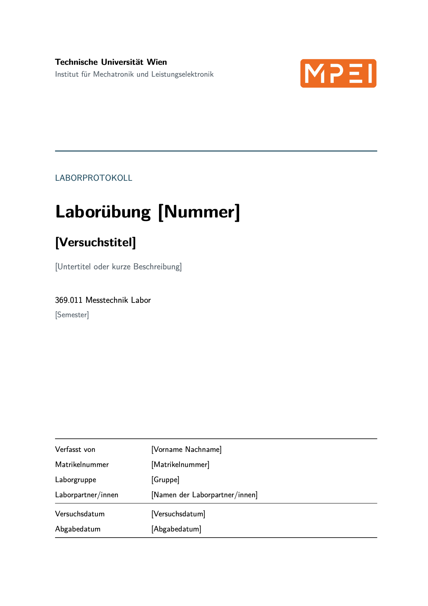

# LaTeX-Vorlage für Laborprotokolle

Die Vorlage enthält das Deckblatt und die Ordnerstruktur zum Weiterarbeiten.
Beim Kompilieren entsteht zunächst ausschließlich das Deckblatt. Persönliche
Angaben, Versuchsinhalte, Messdaten und Auswertungen sind nicht enthalten.
Hochschule, Institut und Lehrveranstaltung sind für das Messtechnik Labor
voreingestellt und können ebenfalls geändert werden.

## Vorschau des Deckblatts



## Start

1. Den gesamten Ordner kopieren oder in VS Code öffnen.
2. Die Platzhalter in `protokolldaten.tex` ersetzen.
3. `main.tex` mit einer LaTeX-Installation kompilieren.

In Overleaf: den gesamten Ordner als ZIP hochladen, `main.tex` als Hauptdatei
wählen und mit pdfLaTeX kompilieren.

Für macOS/Linux mit installiertem Tectonic oder latexmk:

```sh
sh scripts/build.sh
```

Die PDF entsteht unter `build/main.pdf`. Tectonic benötigt beim ersten Lauf
Internetzugang zum Laden der Pakete. Compiler und Paketcache werden nicht
mitgeliefert. Alternativ funktioniert pdfLaTeX mit den Paketen aus
`vorlage/praeambel.tex` (z. B. mit TeX Live, MacTeX oder MiKTeX).

In VS Code wird LaTeX Workshop empfohlen. Die mitgelieferte Konfiguration
nutzt das Shell-Skript und ist für macOS/Linux vorgesehen. Unter Windows
`main.tex` direkt mit der eigenen LaTeX-Umgebung kompilieren.

## Ordnerstruktur

```text
LaTeX-Vorlage/
├── main.tex                 Hauptdatei; erzeugt zunächst nur das Deckblatt
├── protokolldaten.tex       Veränderbare Deckblattangaben
├── vorlage/
│   ├── deckblatt.tex        Deckblattgestaltung
│   └── praeambel.tex        Pakete, Farben, Ränder und Kopfzeilen
├── kapitel/                 Leer; hier später Kapitel anlegen
├── daten/                   Leer; für eigene Messdaten
├── bilder/
│   ├── mpei.pdf             Eingebundenes Institutslogo
│   └── mpei.svg             Bearbeitbare Logoquelle
├── scripts/build.sh        PDF-Build für macOS/Linux
├── build/                   Leer; Ausgabeordner beim lokalen Build
└── .vscode/                 Build- und Vorschaukonfiguration
```

Die `.gitkeep`-Dateien erhalten leere Ordner bei einer Übernahme in Git.

## Inhalte ergänzen

Eine Datei `kapitel/protokoll.tex` mit dem eigenen Inhalt anlegen und die
vorbereiteten Zeilen am Ende von `main.tex` aktivieren (führendes `%`
entfernen). Damit werden auch Inhaltsverzeichnis und Seitennummerierung aktiv.
Weitere Kapitel können dort über `\input{kapitel/dateiname}` eingebunden werden.

Das Logo lässt sich in `protokolldaten.tex` austauschen oder durch
`\newcommand{\Logodatei}{}` ausblenden. Bilder im PDF-, PNG- oder JPEG-Format
können direkt eingebunden werden. LaTeX-Sonderzeichen in Textangaben maskieren,
z. B. `\&`, `\%` und `\_`.


